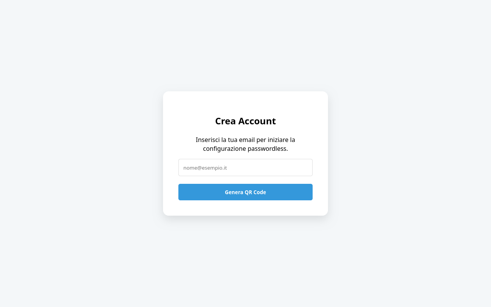
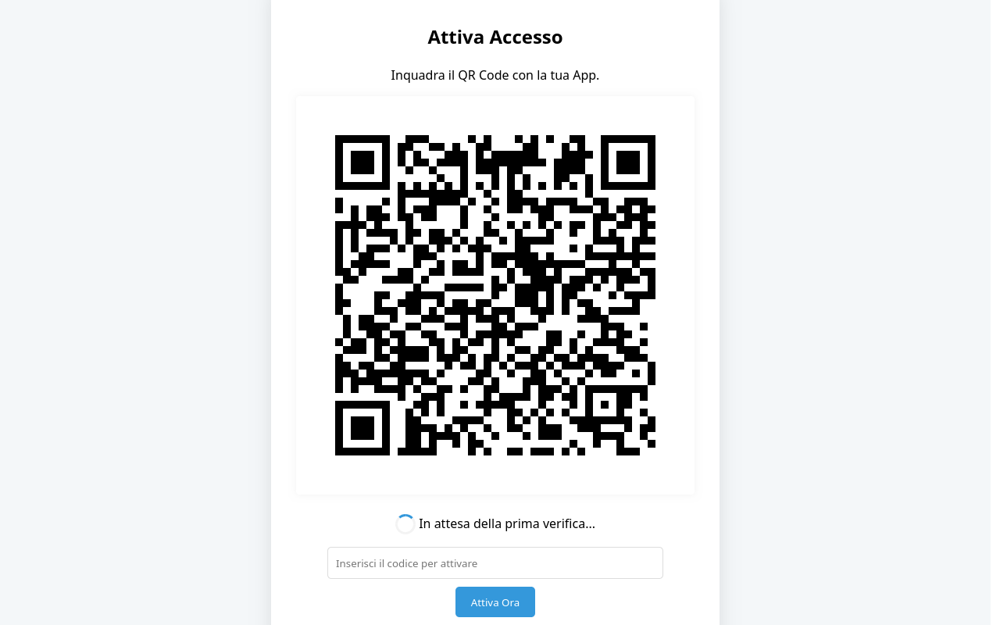
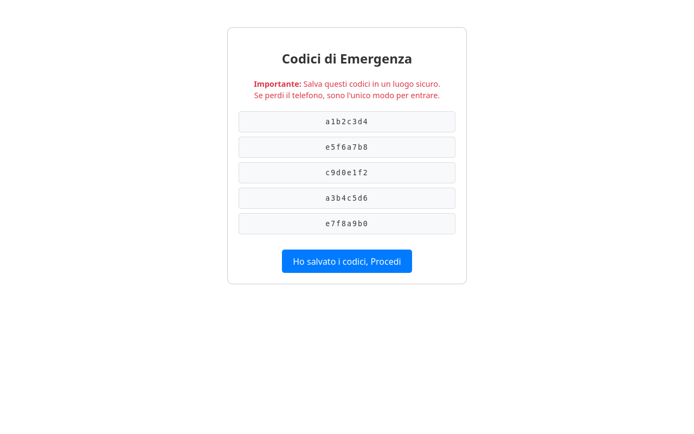
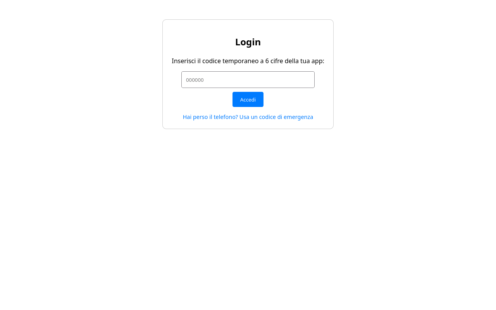
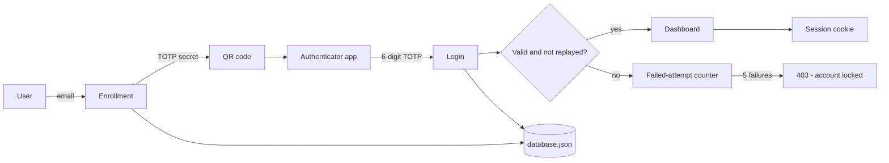
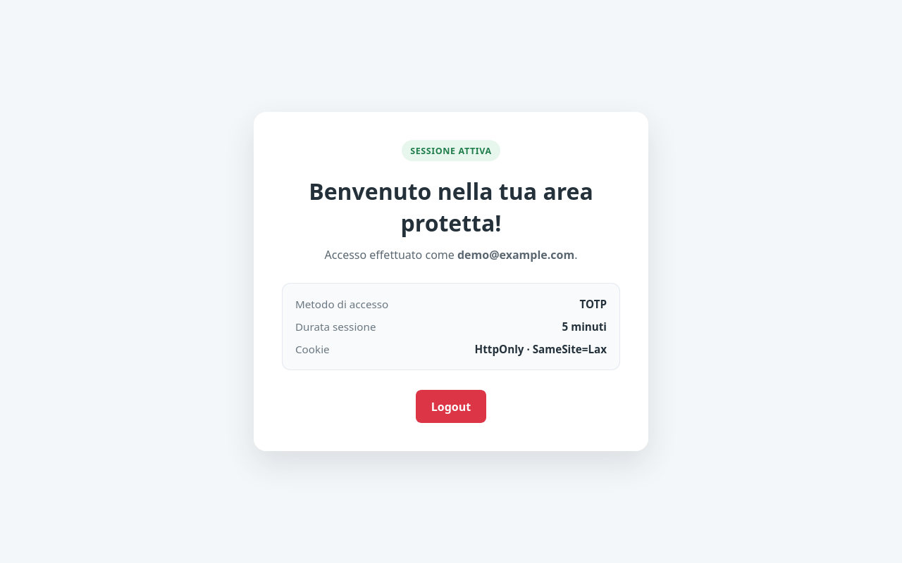
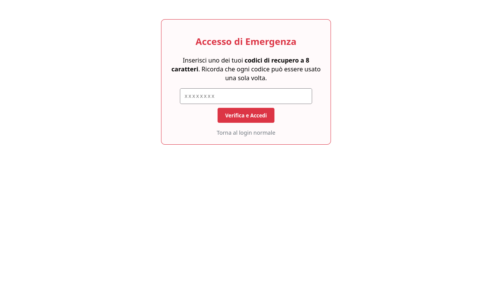
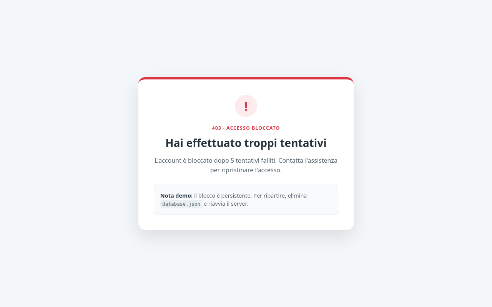

# Secure Passwordless Authentication System

**A hands-on exploration of passwordless authentication, encrypted storage, and offensive security testing.**

[](https://www.python.org/)
[](https://flask.palletsprojects.com/)
[](https://github.com/LaroccaA/Secure-Passwordless-Authentication-System/actions/workflows/tests.yml)
[](LICENSE)
[](https://datatracker.ietf.org/doc/html/rfc6238)
[](https://cryptography.io/en/latest/fernet/)

> Educational proof of concept. Not audited and not intended to protect real accounts.
> See [Security design and limitations](#security-design-and-limitations).

## How I approached cybersecurity

Cybersecurity became concrete for me during my **Information Security** course at university. I had studied the principles behind confidentiality, integrity, authentication, and threat modeling, but I wanted to see what happens when those ideas meet a running application — including the moment when someone tries to break it.

This project started from a simple question: **can authentication work without a password?** I built the full enrollment and login flow with TOTP, then kept asking the next question. If the password disappears, where does the secret go? What happens if the database is stolen? What happens after five wrong codes? What does an attacker see?

I built the first version as part of my coursework and continued working on it on my own. The most valuable part was not adding features, but switching perspective:

- **Build the defense:** passwordless login, encrypted storage, hashed recovery codes, session hardening.
- **Attack the defense:** a multi-threaded brute-force script and a session-hijacking script.
- **Measure the gap:** document what the PoC actually protects against and what it does not.
- **Communicate the trade-offs:** explain the design decisions instead of presenting the project as production-ready.

That process is how I approach security engineering today: understand the threat, implement a control, test it adversarially, and be explicit about the residual risk.

## Overview

This project is a single-user Flask application that replaces static passwords with **time-based one-time passwords (TOTP)**. User data is stored in an encrypted JSON file, recovery codes are stored only as salted hashes, and the login flow includes anti-replay and brute-force protections.

It is intentionally small enough to read end-to-end, but complete enough to demonstrate the full authentication lifecycle:

1. Register an email address.
2. Scan a QR code with an authenticator app.
3. Confirm enrollment with a 6-digit TOTP.
4. Receive five single-use recovery codes.
5. Log in, test the defenses, and inspect the encrypted datastore.

## Screenshots

The screenshots use a disposable demo account. The interface is currently in Italian; this README documents it in English.

| Enrollment | QR setup |
| :---: | :---: |
|  |  |
| **Recovery codes** | **Login** |
|  |  |

## Features

| Area | Implementation |
| --- | --- |
| Passwordless login | 6-digit TOTP, 30-second window, via `pyotp` |
| Encrypted storage | `database.json` encrypted with Fernet (AES-128-CBC + HMAC-SHA256) |
| Recovery codes | Five single-use codes, stored as salted SHA-256 hashes |
| Replay protection | The last used TOTP is rejected |
| Brute-force protection | Account lockout after 5 failed attempts |
| Session hardening | `HttpOnly`, `SameSite=Lax`, 5-minute lifetime |
| Offensive validation | Brute-force and session-hijacking test scripts |

## Architecture



The Flask application keeps the decrypted state in memory and writes the whole encrypted document on every change. The encryption key is loaded from `.env`; it is never stored in the repository.

## Tech stack

- **Python 3.12** and **Flask 3.1**
- **pyotp** for TOTP generation and verification
- **cryptography / Fernet** for authenticated encryption at rest
- **qrcode** and **Pillow** for enrollment QR codes
- **python-dotenv** for local secret loading
- **requests** and `concurrent.futures` for the attack scripts
- **pytest** and **GitHub Actions** for automated verification

## Getting started

### Prerequisites

- Python 3.10 or newer
- Git
- An authenticator app such as Google Authenticator, Aegis, or 1Password

### Installation

```bash
git clone https://github.com/LaroccaA/Secure-Passwordless-Authentication-System.git
cd Secure-Passwordless-Authentication-System

python3 -m venv venv
source venv/bin/activate        # Windows: venv\Scripts\activate
pip install -r requirements.txt
```

### Configuration

Create a local `.env` file from the template and generate a Fernet key:

```bash
test -f .env || cp .env.example .env   # do not overwrite an existing key
python3 -c "from cryptography.fernet import Fernet; print(Fernet.generate_key().decode())"
```

Paste the generated value into `.env`:

```dotenv
DB_SECRET_KEY=<your-generated-key>
```

> Keep `.env` private. Losing the key means losing access to the encrypted database; changing it makes an existing `database.json` unreadable.

### Run

```bash
FLASK_DEBUG=true python3 app.py
```

Open [http://127.0.0.1:5000](http://127.0.0.1:5000).

Debug mode is opt-in. Without `FLASK_DEBUG=true`, the app runs with the debugger disabled.

### First login

1. Enter an email address on the registration page.
2. Scan the QR code with your authenticator app.
3. Enter the current 6-digit code to activate the account.
4. Save the five recovery codes shown on screen — they are displayed only once.
5. Continue to the protected dashboard.



If the authenticator is unavailable, the emergency access page accepts one of the recovery codes:



The application supports **one user** by design. To start over, stop the server and delete `database.json`; the next launch will begin a new enrollment.

## Testing the defenses

The repository includes two small offensive scripts. They are deliberately simple: the goal is to validate the controls and make the attack surface concrete.

### Brute-force protection

Start the server in one terminal:

```bash
FLASK_DEBUG=true python3 app.py
```

Run the attack from a second terminal:

```bash
source venv/bin/activate
python3 brute-force.py
```

The script sends 1,000 random 6-digit codes using 50 workers. After five failures, the server returns **403 Forbidden** and the account is locked.

> Run this only against a local database you can delete: it will lock the only configured account. The lockout is persisted in `database.json`. To run the demo again, stop the server, delete `database.json`, restart, and enroll a new user.



### Session hijacking

After logging in, copy the `session` cookie from the browser developer tools and pass it to the script:

```bash
python3 session-hijacking.py '<session-cookie-value>'
```

The script requests the dashboard with the stolen cookie. The cookie is signed with a per-process secret, so it becomes invalid when the server restarts.

### Encryption at rest

Inspect the beginning of the datastore:

```bash
head -c 32 database.json
# gAAAAA...
```

The file is unreadable without `DB_SECRET_KEY`. Note that this protects data at rest only; a compromised running server can still access the decrypted state.

## Automated tests

The test suite covers enrollment, QR generation, TOTP verification, anti-replay, single-use recovery codes, brute-force lockout, encrypted storage and salted hashing.

```bash
pip install -r requirements-dev.txt
pytest -q
```

The same suite runs in GitHub Actions on every push and pull request to `main` (`.github/workflows/tests.yml`).

## Project structure

```text
.
├── app.py                  # Flask routes and application flow
├── brute-force.py          # Concurrent TOTP guessing simulation
├── session-hijacking.py    # Stolen-cookie replay simulation
├── templates/              # Registration, login, recovery and dashboard pages
├── utility/
│   ├── data_function.py    # Encrypted JSON load/save
│   └── hash_function.py    # Salted hashing and verification for recovery codes
├── tests/test_app.py       # End-to-end authentication tests
├── docs/screenshots/       # Images used in this README
├── .github/workflows/      # GitHub Actions test workflow
├── .env.example            # Template for local configuration
├── requirements.txt        # Runtime dependencies
├── requirements-dev.txt    # Test dependencies
└── database.json           # Generated at runtime, encrypted, ignored by Git
```

## Security design and limitations

| Threat | Control | Residual risk |
| --- | --- | --- |
| Weak or reused passwords | No passwords; TOTP is required | Phishing and real-time code relay are still possible |
| Database theft | Fernet authenticated encryption at rest | A leaked `DB_SECRET_KEY` exposes the data |
| Recovery-code theft | Salted SHA-256, single use | Codes have only 32 bits of entropy; use a slow KDF and more entropy in production |
| Online brute force | Lockout after 5 failed attempts | The lockout is global and has no timed expiry, which is also a denial-of-service vector |
| Session theft | `HttpOnly`, `SameSite=Lax`, short lifetime | The demo runs over HTTP; a stolen cookie works until the server restarts |
| TOTP replay | Last used token is rejected | Only the most recent token is tracked |

This is a proof of concept, not a production authentication system. The main simplifications are:

- Single-user JSON storage with no migrations or write locking.
- Flask development server; no TLS, reverse proxy, or production WSGI setup.
- No CSRF tokens; `SameSite=Lax` reduces but does not eliminate CSRF risk.
- No per-IP rate limiting, audit log, multi-device support, or WebAuthn.
- Test coverage is intentionally small and focuses on the authentication flow.

## Roadmap

- [ ] Add WebAuthn / passkeys as a second passwordless factor.
- [ ] Replace salted SHA-256 with Argon2id and increase recovery-code entropy.
- [ ] Move persistence to SQLite or PostgreSQL with migrations and locking.
- [ ] Add CSRF protection and security headers.
- [ ] Add per-IP and per-account rate limiting with expiry.
- [x] Add `pytest` tests and a GitHub Actions workflow.

## What I learned

- **Security is a set of trade-offs, not a checklist.** Every control adds complexity, failure modes, and operational cost.
- **A defense is only credible after you attack it.** Writing the brute-force and session-hijacking scripts exposed assumptions that the happy-path tests did not.
- **Documenting limitations is part of the work.** A clear threat model is more useful than claiming that a PoC is secure.

## Author

**Andrea Larocca** — [github.com/LaroccaA](https://github.com/LaroccaA)

Built as part of my Information Security coursework and continued as a self-study project.

## License

Released under the [MIT License](LICENSE).

## Disclaimer

This project is provided for educational purposes. It has not been audited and should not be used to protect real accounts or sensitive data.
